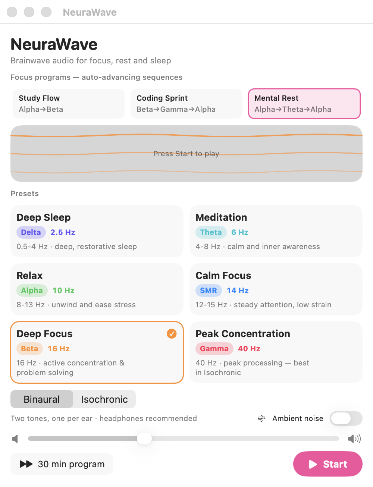

<div align="center">

# 🌊 NeuraWave

**Brainwave audio for focus, rest and sleep** — a tiny native macOS app with
science-tuned binaural & isochronic tones, auto-advancing focus programs, and a
menu bar soul.



[](https://github.com/AkiyamaKunka/NeuraWave/actions)
[](LICENSE)
[]()
[](https://github.com/AkiyamaKunka/NeuraWave/releases)

<a href="https://github.com/AkiyamaKunka/NeuraWave/releases/latest">
  
</a>

</div>

---

## Why NeuraWave

- 🎯 **Frequencies tuned to evidence, not hype.** Deep Focus runs at 16 Hz — the
  beta rate Lane et al. (1998) actually tested for vigilance. Calm Focus sits at
  14 Hz SMR. 40 Hz gamma honestly recommends Isochronic mode. Every choice is
  sourced in [RESEARCH.md](RESEARCH.md).
- 🧭 **Focus programs that plan your session.** Study Flow settles you with Alpha,
  then ramps into Beta. Coding Sprint warms up, peaks at Gamma, then cools down.
  Mental Rest descends into Theta and brings you back — all with click-free
  crossfade transitions.
- 🌙 **Lives in the menu bar.** Close the window and it keeps playing; pick
  presets, pause or stop right from the menu. Starts at login silently — no
  sound until you press Start. Sleep timers ease out gently over the last 30 s.
- 🔋 **Light on battery.** Under 1% CPU while playing, window open or not.
- 🎧 **AirPods & Now Playing.** Single-press pauses/resumes with a click-free
  fade, double-press skips presets, and live progress appears in Control Center.
- 🔒 **Zero noise.** No accounts, no analytics, no network calls. Free, open
  source, MIT.

## 🎛 Presets

| Preset | Band | Beat | Best for |
| --- | --- | --- | --- |
| Deep Sleep | Delta | 2.5 Hz | Deep, restorative sleep |
| Meditation | Theta | 6 Hz | Calm and inner awareness |
| Relax | Alpha | 10 Hz | Unwinding and stress relief |
| Calm Focus | SMR | 14 Hz | Steady attention, low strain |
| Deep Focus | Beta | 16 Hz | Active concentration and coding |
| Peak Concentration | Gamma | 40 Hz | Peak processing (best in Isochronic) |

## 🧭 Focus programs

| Program | Sequence | Total |
| --- | --- | --- |
| Study Flow | Alpha settle (10 min) → Beta focus (30 min) | 40 min |
| Coding Sprint | Beta warm-up (8 min) → Gamma peak (30 min) → Alpha cool-down (5 min) | 43 min |
| Mental Rest | Alpha (6 min) → Theta (20 min) → Alpha return (4 min) | 30 min |

## 📦 Install

1. Download the latest **NeuraWave-<version>.dmg** from [Releases](https://github.com/AkiyamaKunka/NeuraWave/releases/latest).
2. Open the DMG and drag NeuraWave into **Applications**.
3. First launch: **right-click → Open** (ad-hoc signed; Gatekeeper asks once, then it launches normally).

> Signed & notarized builds (no right-click step) need an Apple Developer
> account — the CI pipeline is ready for it.

## 🔬 The science

Binaural beats show a medium effect in meta-analysis (Garcia-Argibay et al.,
2019, g ≈ 0.45) with real but weak cortical entrainment (Orozco Perez et al.,
2020), and results vary by person. NeuraWave is honest about that — the full
frequency rationale lives in [RESEARCH.md](RESEARCH.md).

## 🔨 Build from source

```bash
swift build                          # debug build
bash scripts/package-app.sh release  # assembles build/NeuraWave.app
bash scripts/make-dmg.sh             # dist/NeuraWave-<version>.dmg
```

What changed between versions is in [CHANGELOG.md](CHANGELOG.md).

## 🗂 Code map

| File | What lives there |
| --- | --- |
| `Models.swift` | Presets, focus programs, tone styles, volume range, time formatting |
| `SettingsStore.swift` | Everything remembered between launches (typed, with safe fallbacks) |
| `SessionController.swift` | The one playback session: start/stop, pause/resume, timers, programs, Now Playing |
| `SessionClock.swift` | Pause-aware elapsed/remaining time (pure, unit tested) |
| `SessionDependencies.swift` | `AudioOutput` / `NowPlayingPublishing` protocols, so the session is testable without audio |
| `AudioEngine.swift` | AVAudioEngine lifecycle: output chain, pause release, device-change rebuilds |
| `RealtimeRenderer.swift` | The audio-thread renderer: lock-safe state handoff, phasor oscillators, fades, noise |
| `ContentView.swift`, `WindowSections.swift`, `WaveformView.swift` | The window |
| `MenuBarController.swift`, `NowPlayingController.swift` | Menu bar item; AirPods / Control Center commands |
| `LoginItem.swift`, `MainWindow.swift` | Launch at Login; showing, hiding and reopening the main window |
| `AutoTest.swift`, `DeveloperTools.swift` | Hidden self-test mode, `--screenshot`, window probe |

## 🧪 Testing

Unit tests (`swift test`) run without audio hardware:

- **Render path:** fades, click-free switching, bounded output for every preset, oscillator accuracy, a concurrent-render race test, and render cost.
- **Session logic:** timers, pause, programs, skipping, saved settings and failure paths, all driven by a fake audio output and a manual clock.
- **Settings, timing and formatting:** stored settings, pause-aware timing, option parsing and display strings.

```bash
swift test
```

A hidden self-test mode drives the real app through every preset, tone style,
noise setting, volume change, timer, program and stop/restart path. It runs
without a window and stays out of Now Playing; add `--autotest-volume 0` to
make it silent.

```bash
# 8-second smoke test
build/NeuraWave.app/Contents/MacOS/NeuraWave --autotest --autotest-seconds 8 --autotest-cycle 2

# Every short scenario in parallel (~75 s), as CI runs them
swift build && bash scripts/quick-tests.sh --autotest-volume 0

# Full battery incl. a 30-minute endurance run, with pass/fail reporting
bash scripts/run-tests.sh
AUTOTEST_EXTRA_ARGS="--autotest-volume 0" bash scripts/run-tests.sh   # silent
```

Every run ends with a `SWITCH_CHECK` line. It checks that each requested
preset/style change was either applied by the audio thread or superseded by a
newer one, and `run-tests.sh` fails a scenario on any mismatch or failed
in-run check. Extra probes:

- `--autotest-pause-at N --autotest-resume-at M`: pause and resume.
- `--autotest-device-change-at N`: simulated output-device switch.
- `--autotest-window-check`: close and reopen the window (needs an awake display).
- `--autotest-show-window`: keep the window on screen.
- `--autotest-now-playing`: publish Now Playing during the run.

CI on GitHub Actions runs a Swift 6 strict-concurrency build, the unit tests,
and every `quick-tests.sh` scenario on a clean macOS runner for every push.

## 🛟 Safety

- Avoid theta/delta audio when driving or operating machinery (drowsiness).
- Not for people with seizure disorders triggered by rhythmic stimuli.
- For relaxation and focus only — not medical advice, not a treatment for
  sleep or attention disorders.

## 📄 License

[MIT](LICENSE) © 2026 AkiyamaKunka
